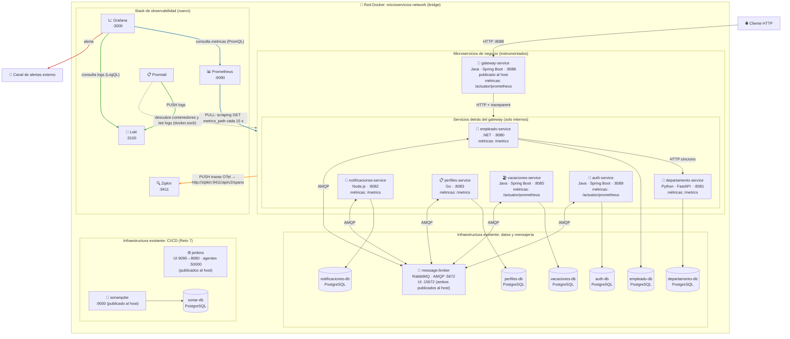

# Sistema de Gestión de Empleados — Proyecto Final de Microservicios

Sistema de onboarding de empleados construido como un conjunto de microservicios
independientes, cada uno con su propia base de datos, que se comunican de forma
síncrona (HTTP, a través de un API Gateway) y asíncrona (eventos sobre RabbitMQ)..


## Índice

- [Servicios del sistema](#servicios-del-sistema)
- [Arquitectura](#arquitectura)
- [Comunicación asíncrona (RabbitMQ)](#comunicación-asíncrona-rabbitmq)
- [API Gateway](#api-gateway)
- [Circuit Breaker de EmpleadoService](#circuit-breaker-de-empleadoservice)
- [Endpoints por servicio](#endpoints-por-servicio)
- [Puesta en marcha](#puesta-en-marcha)
- [Esquemas de base de datos](#esquemas-de-base-de-datos)
- [Pruebas automatizadas](#pruebas-automatizadas)
- [Documentación adicional por servicio](#documentación-adicional-por-servicio)
- [Puntos no verificados / limitaciones conocidas](#puntos-no-verificados--limitaciones-conocidas)

## Servicios del sistema

| Servicio | Carpeta | Tecnología (según código) | Base de datos | Puerto interno |
|---|---|---|---|---|
| `gateway-service` | `gateway-service/` | Java 21, Spring Boot 4.0.8, Spring Cloud Gateway (`spring-cloud.version` 2025.1.3) | — | `8088` (único puerto publicado al host) |
| `empleado-service` | `empleado-service/` | ASP.NET Core (.NET 10) | PostgreSQL 17 (`empleado-db`) | `8080` |
| `departamento-service` | `departamento-service/` | Python 3.11, FastAPI 0.116, SQLAlchemy 2.0 | PostgreSQL 17 (`departamento-db`) | `8081` |
| `notificaciones-service` | `notificaciones-service/` | Node.js ≥20, Express, cliente `pg` sin ORM | PostgreSQL 17 (`notificaciones-db`) | `8082` |
| `perfiles-service` | `perfiles-service/` | Go (`go.mod` declara `go 1.25`), chi router | PostgreSQL 17 (`perfiles-db`) | `8083` |
| `vacaciones-service` | `vacaciones-service/` | Java 21, Spring Boot 4.1.1 | PostgreSQL 17 (`vacaciones-db`) | `8085` |
| `auth-service` | `auth-service/` | Java 21, Spring Boot 4.1.1, Spring Security | PostgreSQL 17 (`auth-db`) | `8089` |
| `message-broker` | imagen `rabbitmq:3-management` | RabbitMQ con plugin de administración | — | `5672` (AMQP) y `15672` (UI), ambos publicados al host |

Todos los contenedores comparten la red `microservicios-network` (definida en
`docker-compose.yml` con `driver: bridge`). Según ese archivo, **el único
servicio de aplicación que publica un puerto al host es `gateway-service`**
(`ports:`); el resto de los microservicios y las bases de datos usan `expose:`,
es decir, solo son alcanzables entre contenedores. `message-broker` es la
excepción: publica sus dos puertos (AMQP y la interfaz de administración) al
host directamente.

## Arquitectura

```text
Cliente HTTP
     |
     | http://localhost:8088
     v
gateway-service (Spring Cloud Gateway)
     |------------|------------|------------|------------|
     v            v            v            v            v
registro-   departamentos-  perfiles-   notificaciones- vacaciones-
service     service         service     service         service
     |            |            |            |               |
     v            v            v            v               v
registro-   departamentos-  perfiles-   notificaciones-  vacaciones-
db          db              db          db               db

empleado-service --- REST síncrono con Circuit Breaker (Polly) ---> departamento-service

empleado-service, perfiles-service, notificaciones-service y vacaciones-service
se conectan además a message-broker (RabbitMQ) para publicar y/o consumir eventos.
```


## Comunicación asíncrona (RabbitMQ)

- El broker es una única instancia de `rabbitmq:3-management` (contenedor
  `rabbitmq-broker`), con un exchange **fanout** llamado `empleados_exchange`
  (declarado como `durable: true` en `empleadoService/infrastructure/messaging/RabbitMqPublisher.cs`).
- `empleado-service` publica en ese exchange los eventos `empleado.creado`,
  `empleado.actualizado` y `empleado.retirado` (ver
  `empleadoService/domain/services/EmpleadoService.cs`).
- `vacaciones-service` publica `vacaciones.programadas`,
  `vacaciones.iniciadas` y `vacaciones.finalizadas` en el mismo exchange después
  del commit. Los eventos incluyen `version: "1.0"` y datos de vacaciones; el
  scheduler y el contrato se documentan en [`vacaciones-service/README.md`](vacaciones-service/README.md).
- `notificaciones-service`, `perfiles-service` y `vacaciones-service` consumen
  ese exchange, cada uno con su propia cola durable y su propia cola de
  mensajes muertos (DLQ):

  | Servicio consumidor | Cola | DLQ | Eventos que procesa |
  |---|---|---|---|
  | `notificaciones-service` | `notificaciones.empleados` | `notificaciones.empleados.dlq` | `empleado.creado`, `empleado.retirado`, `vacaciones.programadas` (otros tipos se reconocen y se descartan sin error) |
  | `perfiles-service` | `perfiles.empleados` | (nombre de cola + `.dlq`) | `empleado.creado`, `empleado.actualizado`, `empleado.retirado` |
  | `vacaciones-service` | `vacaciones.empleados` (por defecto) | `vacaciones.empleados.dlq` | `empleado.creado`, `empleado.actualizado`, `empleado.retirado` (cancela vacaciones `PROGRAMADA` al retirar) |

- Los tres consumidores toleran envelopes en PascalCase o camelCase y usan
  confirmación manual (`ack`/`nack`): un envelope mal formado va directo a la
  DLQ (no tiene sentido reintentarlo); un error transitorio (por ejemplo, la
  base de datos propia caída) se reencola.

## API Gateway

Configuración real en `gateway-service/src/main/resources/application.yml`.

### Tabla de rutas

| Ruta externa | Servicio destino | Variable de entorno que define la URL |
|---|---|---|
| `GET /health` | Resuelto por el propio Gateway (`GatewayController`) | — |
| `/auth/**` | `auth-service` | `AUTH_SERVICE_URL` |
| `/empleados/**` | `empleado-service` | `EMPLEADOS_SERVICE_URL` |
| `/departamentos/**` | `departamento-service` | `DEPARTAMENTO_SERVICE_URL` |
| `/perfiles/**` | `perfiles-service` | `PERFILES_SERVICE_URL` |
| `/notificaciones/**` | `notificaciones-service` | `NOTIFICACIONES_SERVICE_URL` |
| `/vacaciones/**` | `vacaciones-service` | `VACACIONES_SERVICE_URL` |

Cada ruta tiene su propio Circuit Breaker de Resilience4j
(`empleadosServiceCircuitBreaker`, `departamentoServiceCircuitBreaker`, etc.),
todos configurados con la misma plantilla: ventana deslizante de 10 llamadas,
umbral de fallos del 50 % y 10 segundos en estado abierto, con un
`timeLimiter` de 6 segundos por llamada. Si el destino no responde a tiempo o
falla, el Gateway reenvía la petición a `/fallback/{service}`
(`GatewayController.unavailable`), que responde `503 Service Unavailable` con
un cuerpo como este:

```json
{
  "error": "service_unavailable",
  "message": "El microservicio destino no está disponible",
  "service": "departamento-service",
  "path": "/fallback/departamento-service"
}
```

`GET /health` en el Gateway solo confirma que el propio proceso responde
(`{"status": "healthy"}`); no verifica el estado de los servicios destino.

El Gateway valida los Access JWT antes de reenviar rutas protegidas. Comprueba
la firma, expiración, `sub`, rol (`ADMIN` o `USER`) y rechaza los tokens de
recuperación. Las rutas públicas son salud, fallbacks, documentación y
`/auth/login`, `/auth/recover-password` y `/auth/reset-password`. Después de
validar, elimina las cabeceras de identidad recibidas del cliente e inyecta
`X-User-Id` y `X-User-Role` a partir de los claims verificados.

## Circuit Breaker de EmpleadoService

Independientemente del Circuit Breaker del Gateway, `empleado-service`
implementa el suyo propio para su llamada síncrona hacia
`departamento-service`, usando Polly (`DepartamentoCircuitBreaker.cs`,
`DepartamentoClient.cs`).

| Parámetro | Variable de entorno | Rango válido según `DepartamentosResilienceOptions` |
|---|---|---|
| Fallos consecutivos antes de abrir | `CB_FALLOS_CONSECUTIVOS` | 3 a 5 |
| Timeout de cada intento | `CB_TIMEOUT_LLAMADA` | — |
| Duración del estado abierto | `CB_DURACION_CIRCUITO_ABIERTO` | entre 30 y 60 segundos |

El servicio valida estos valores al arrancar (`ValidateOnStart`) y falla si
están fuera de rango. El estado del circuito (`CLOSED`, `OPEN`, `HALF_OPEN`) se
mantiene en un singleton y puede consultarse desde la red interna del
contenedor:

```bash
docker compose exec -T empleado-service curl -s http://localhost:8080/health/circuit-breaker
```

Cuando `departamento-service` no está disponible o el circuito está abierto,
`empleado-service` registra al empleado igualmente con estado
`PENDIENTE_VALIDACION` (fallback orientado a disponibilidad), mientras que un
error propio del dominio (por ejemplo, un `departamentoId` inexistente
respondido con `404`) no activa el fallback y se traduce en `400 Bad Request`.

## Endpoints por servicio

Los siguientes endpoints se verificaron directamente contra el código fuente
de cada servicio (rutas HTTP definidas en su respectivo router/controlador).
Todos son accesibles desde el host únicamente a través del Gateway en
`http://localhost:8088`, salvo indicación contraria.

### `empleado-service` (`/empleados`)

- `POST /empleados` — registra un empleado. Responde `201 Created`
  (`ACTIVO` o `PENDIENTE_VALIDACION` según la disponibilidad de
  `departamento-service`), `400` en errores de validación o departamento
  inexistente, `409` si el email, `numeroEmpleado` o `id` ya existen.
- `GET /empleados/{id}` — consulta un empleado por id. `404` si no existe.
- `PUT /empleados/{id}` — actualiza los datos de un empleado y publica
  `empleado.actualizado`.
- `GET /empleados?estado=RETIRADO&desde=&hasta=` — lista empleados retirados,
  con filtro opcional de fechas. Cualquier otro valor de `estado` (u
  omitirlo) responde `400 Bad Request`, ya que solo se soporta la consulta de
  retirados.
- `DELETE /empleados/{id}` — baja lógica: cambia el estado a `RETIRADO`,
  registra `fechaRetiro`, publica `empleado.retirado` y responde `204`.
- `GET /health` y `GET /health/ready` — liveness y readiness (este último
  valida la conexión a `empleado-db`).
- `GET /health/circuit-breaker` — estado del circuito hacia
  `departamento-service` (ver sección anterior).

### `departamento-service` (`/departamentos`)

- `POST /departamentos` — crea un departamento. `201 Created`.
- `GET /departamentos/{id}` — consulta un departamento por id. `404` si no
  existe.
- `GET /departamentos` — lista todos los departamentos.
- `GET /health` y `GET /health/ready`.

### `perfiles-service` (`/perfiles`)

- `GET /perfiles` — lista los perfiles.
- `GET /perfiles/{empleadoId}` — consulta el perfil de un empleado. `404` si
  no existe.
- `PUT /perfiles/{empleadoId}` — actualiza campos propios del perfil
  (`telefono`, `direccion`, `ciudad`, `biografia`, según su propio README).
- `GET /health/live` y `GET /health/ready`.
- `GET /swagger/*` — documentación Swagger servida por el propio servicio.

### `notificaciones-service` (`/notificaciones`)

- `GET /notificaciones` — historial completo, más reciente primero.
- `GET /notificaciones/{empleadoId}` — historial de un empleado (`[]` si no
  tiene notificaciones; el servicio no valida contra el catálogo de
  empleados).
- `GET /health` y `GET /health/ready`.
- `GET /docs` — documentación Swagger/OpenAPI generada desde el código de las
  rutas.

### `vacaciones-service` (`/vacaciones`)

- `POST /vacaciones` — crea una solicitud de vacaciones (fechas inclusivas,
  sin solapamiento con otro período activo del mismo empleado).
- `GET /vacaciones/{id}` — consulta una solicitud por id.
- `GET /vacaciones?empleadoId=` — lista solicitudes, con filtro opcional por
  empleado.
- `DELETE /vacaciones/{id}` — cancela un período; según su propio README,
  solo aplica a períodos en estado `PROGRAMADA`.
- `GET /health` y `GET /health/ready`.
- `/vacaciones/docs` y `/vacaciones/api-docs` — documentación OpenAPI
  (rutas indicadas en el README propio del servicio).

### `gateway-service`

- `GET /health` — salud del propio Gateway.
- `GET /fallback/{service}` — respuesta de indisponibilidad usada
  internamente por el enrutamiento cuando un Circuit Breaker se abre.

### `auth-service` (`/auth`)

- `POST /auth/login` — autentica credenciales y emite el JWT de acceso.
- `POST /auth/recover-password` — inicia la recuperación de contraseña.
- `POST /auth/reset-password` — consume un token de recuperación.
- `POST /auth/change-password` — cambia la contraseña de una cuenta autenticada.
- `GET /actuator/health` — healthcheck interno usado por Docker Compose.

El servicio no publica su puerto al host; las rutas de negocio se consumen a
través del Gateway. La validación JWT y la autorización RBAC están
centralizadas allí.

### Matriz RBAC del Gateway

| Operación | `USER` | `ADMIN` |
|---|---|---|
| Rutas públicas y `OPTIONS` | Permitido | Permitido |
| `GET`/`HEAD` de empleados, departamentos, perfiles, notificaciones y vacaciones | Permitido | Permitido |
| `POST /auth/change-password` | Permitido | Permitido |
| `PUT /perfiles/{empleadoId}` propio | Permitido | Permitido |
| `PUT /perfiles/{empleadoId}` ajeno | `403 Forbidden` | Permitido |
| Demás operaciones de escritura | `403 Forbidden` | Permitido |

La propiedad del perfil se comprueba comparando `{empleadoId}` con el `sub`
del JWT. Las denegaciones de un usuario autenticado se devuelven como JSON con
estado `403`; un token ausente o inválido conserva la respuesta `401`.

Swagger UI está disponible en `/swagger-ui.html` y la especificación en
`/v3/api-docs`. OpenAPI declara el esquema HTTP `BearerAuth` con formato JWT;
el botón **Authorize** de Swagger UI acepta el access token emitido por
`POST /auth/login` y conserva la autorización mientras se navega por la UI.
La interfaz del Gateway agrega las especificaciones de los servicios en un
selector: Gateway, autenticación, empleados, departamentos, perfiles,
notificaciones y vacaciones. Cada especificación también se puede consultar en
`/openapi/{servicio}` (por ejemplo, `/openapi/vacaciones`). Las rutas OpenAPI se
mantienen públicas para cargar la documentación; las operaciones de negocio
siguen sujetas al JWT y a las reglas RBAC descritas arriba. Para probar
operaciones desde Swagger, primero ejecuta `POST /auth/login`, copia el valor
`token` y pégalo en **Authorize** (Swagger UI añade automáticamente el prefijo
`Bearer`).

Las rutas de especificaciones agregadas son `/v3/api-docs` (Gateway),
`/openapi/auth`, `/openapi/registro`, `/openapi/departamentos`,
`/openapi/perfiles`, `/openapi/notificaciones` y `/openapi/vacaciones`. Algunas
especificaciones también pueden consultarse directamente si el servicio está
accesible: Departamentos en `/docs`, Notificaciones en `/docs`, Perfiles en
`/swagger/index.html` y Vacaciones en `/swagger-ui.html`. En el despliegue
Docker normal, el Gateway es el único puerto de aplicación publicado al host;
por ello se recomienda usar la interfaz agregada.
La especificación de autenticación usa una URL relativa para que Swagger envíe
`/auth/login` al mismo origen del Gateway (por ejemplo, `http://localhost:8088`)
y no intente acceder desde el navegador al hostname interno `auth-service`.

## Puesta en marcha

### Requisitos

- Docker y Docker Compose.
- Un archivo `.env` en la raíz del repositorio con las variables que exige
  `docker-compose.yml` (ver `.env.example` como referencia; todas las
  variables allí marcadas están declaradas como obligatorias mediante la
  sintaxis `${VARIABLE:?...}`, por lo que Compose no arrancará sin ellas).

### Encender el sistema

Ejecutar desde la raíz del repositorio:

```bash
cp .env.example .env   # y ajustar valores si es necesario
docker compose up --build -d
docker compose ps
```

Según las dependencias declaradas en `docker-compose.yml`
(`depends_on` con `condition: service_healthy`), el arranque respeta este
orden: primero las bases de datos y `message-broker`; luego
`departamento-service`; después `empleado-service`, `perfiles-service`,
`notificaciones-service`, `vacaciones-service` y `auth-service` (cada uno depende de su base
de datos y, cuando aplica, de `message-broker`); y por último
`gateway-service`, que depende de que los seis microservicios de aplicación
estén sanos.

Verificación mínima:

```bash
curl -i http://localhost:8088/health
curl -i http://localhost:8088/departamentos
```

### Apagar sin borrar datos

```bash
docker compose down
```

`docker compose down --volumes` elimina los volúmenes (`empleado-data`,
`departamento-data`, `notificaciones-data`, `perfiles-data`,
`vacaciones-data`) y obliga a que las bases de datos vuelvan a inicializarse
desde los scripts en `database/`.

## Esquemas de base de datos

Los scripts iniciales de cada base de datos están en `database/`, organizados
por servicio, y se montan como `/docker-entrypoint-initdb.d` de forma
`read-only` en el contenedor de PostgreSQL correspondiente:

```text
database/
  empleado/001-schema.sql
  departamentos/001-schema.sql
  notificaciones/001-schema.sql
  perfiles/001-schema.sql
  vacaciones/001-schema.sql
```

## Pruebas automatizadas

Cada servicio mantiene su propia suite de pruebas, en su propia carpeta.
Para este cambio se ejecutó la suite de `vacaciones-service` (17 pruebas
correctas); las demás filas indican cómo correr sus suites:

| Servicio | Cómo correr las pruebas | Archivos de prueba encontrados |
|---|---|---|
| `empleado-service` | `cd empleado-service && dotnet test EmpleadoService.sln` | `EmpleadosEndpointsTests.cs`, `EmpleadoServiceTests.cs`, `EmpleadoRepositoryTests.cs`, `DepartamentosResilienceOptionsTests.cs`, `DepartamentoClientTests.cs` |
| `departamento-service` | `cd departamento-service && pip install -r requirements-dev.txt && pytest -q` | `test_departamentos.py`, `test_resiliencia.py` |
| `notificaciones-service` | `cd notificaciones-service && npm test` (Jest + Supertest) | `eventoParser.test.js`, `notificacionService.test.js`, `api.test.js` |
| `perfiles-service` | `cd perfiles-service && go test ./...` | `internal/api/router_test.go`, `internal/messaging/consumer_test.go` |
| `vacaciones-service` | `mvn -f vacaciones-service/pom.xml test` | Validación de fechas, scheduler, transiciones tras retiro y payload RabbitMQ |
| `auth-service` | `cd auth-service && ./mvnw test` | `AuthServiceApplicationTests.java`, `AccountLifecycleServiceTest.java`, `JsonConverterAndConsumerTest.java` |
| `gateway-service` | `cd gateway-service && mvn test` | Pruebas RBAC, autenticación JWT y autorización de propiedad de perfil |

## Documentación adicional por servicio

Varios servicios incluyen su propio `README.md` con más detalle del que cabe
aquí (variables de entorno completas, estructura interna, justificación de
decisiones técnicas):

- [`empleado-service/README.md`](empleado-service/README.md)
- [`perfiles-service/README.md`](perfiles-service/README.md)
- [`notificaciones-service/README.md`](notificaciones-service/README.md) (incluye además `DOC/Notificaciones-Diseno.md`)
- [`vacaciones-service/README.md`](vacaciones-service/README.md)
- [`docs/evidencias/reto5/README.md`](docs/evidencias/reto5/README.md) y su [colección Postman](docs/evidencias/reto5/reto5-integracion.postman_collection.json)
- [Flujo de empleado con autenticación JWT desde PowerShell](docs/evidencias/reto5/pruebas-flujo-auth-powershell.md)

`departamento-service` y `gateway-service` no tienen un `README.md` propio
en el repositorio.

## Puntos no verificados / limitaciones conocidas

- `VacationScheduler` asume una sola instancia; N réplicas pueden publicar N
  veces. El Reto 31 incorporará coordinación distribuida con ShedLock.

## Pruebas Automatizadas y Reportes (Reto 6)

### Pirámide de pruebas

| Nivel | Qué valida | Dependencias | Dónde |
|---|---|---|---|
| Unitarias (base) | Reglas de negocio de una sola clase, con test doubles (mocks/fakes) | Ninguna: no necesitan Docker ni BD | `vacaciones-service` (JUnit 5 + Mockito), `empleado-service` (xUnit), `auth-service`, `gateway-service`, `departamento-service` (pytest), `notificaciones-service` (Jest), `perfiles-service` (go test) |
| Integración (medio) | Consultas SQL y restricciones contra una BD real | Docker (Testcontainers, `postgres:17-alpine`) | `vacaciones-service`: `VacationRepositoryIntegrationTest` |
| E2E / BDD (cima) | Flujos de negocio completos a través del gateway, RabbitMQ y las BD reales | Stack completo de `docker compose` | `e2e-tests/` |

**BDD** (Behavior-Driven Development): los escenarios se escriben en Gherkin en español (`Dado / Cuando / Entonces`),
así negocio y QA leen el mismo documento ejecutable. Se usa **Cucumber-JVM** con Rest Assured. Los resultados asincrónicos
(RabbitMQ) se verifican con *polling* con reintentos (`support/Polling.java`: 15 intentos, cada 2 s, tope de 90 s), sin pausas fijas.

### Reportes por suite

Cada suite se ejecuta con un único comando y falla con código de salida distinto de 0 si alguna prueba falla.

| Suite | Comando (desde la raíz del repo) | Resultados de pruebas | Cobertura |
|---|---|---|---|
| `vacaciones-service` (unit + integración) | `mvn -f vacaciones-service/pom.xml verify` | `vacaciones-service/target/surefire-reports/*.xml` (JUnit XML) | `vacaciones-service/target/site/jacoco/index.html` y `jacoco.xml` (mínimo 70 % de líneas; actual 87,8 %) |
| `empleado-service` | `dotnet test empleado-service/empleadoService.Tests/EmpleadoService.Tests.csproj --collect:"XPlat Code Coverage" --logger trx --settings empleado-service/empleadoService.Tests/EmpleadoService.Tests.runsettings` | `empleado-service/empleadoService.Tests/TestResults/*.trx` | `empleado-service/empleadoService.Tests/TestResults/<GUID>/coverage.cobertura.xml` |
| `auth-service` | `cd auth-service && ./mvnw clean verify` | `auth-service/target/surefire-reports/*.xml` | `auth-service/target/site/jacoco/index.html` y `jacoco.xml` (71,0 % de líneas; solo reporte, sin umbral) |
| **`e2e-tests` (BDD)** | `cd e2e-tests && mvn clean test` | `e2e-tests/reports/junit.xml` (JUnit XML)<br>`e2e-tests/reports/cucumber.json` (Cucumber JSON) | `e2e-tests/reports/cucumber.html` (informe HTML navegable) |

Los reportes BDD se generan en `e2e-tests/reports/` en cada ejecución (carpeta ignorada por git, no se versiona); Jenkins (Reto 7) los consume desde esa ruta.

### Ejecución de las pruebas BDD (paso a paso)

**Prerrequisitos:** Docker Desktop encendido, JDK 21, Maven 3.9+ y el archivo `.env` de la raíz creado a partir de `.env.example`.
Para el ciclo de vacaciones la suite usa los endpoints manuales del scheduler, así que `.env` debe tener `VACACIONES_MANUAL_ENABLED=true`
(el valor por defecto es `false`).

1. Levantar el sistema desde la raíz: `docker compose up -d --build` y esperar a que los contenedores estén `healthy` (`docker compose ps`).
2. Exportar las variables de la suite (ver `e2e-tests/.env.example`): como mínimo `E2E_ADMIN_EMAIL`, `E2E_ADMIN_PASSWORD` (los `ADMIN_*` del `.env`)
   y `E2E_JWT_SECRET` (el `JWT_SECRET_KEY` del `.env`). Las credenciales USER son opcionales: si no se definen, la suite crea una cuenta USER efímera.
3. Ejecutar: `cd e2e-tests && mvn clean test`. Solo el smoke: `mvn test -Dcucumber.filter.tags="@smoke"`.
4. Abrir `e2e-tests/reports/cucumber.html` en el navegador.

**Escenarios implementados (19):**
* **Smoke (`smoke.feature`):** `/health` del gateway y OpenAPI público.
* **Seguridad (`seguridad.feature`):** token ausente y malformado (401), USER solo lectura (403 al escribir) y ADMIN con acceso completo.
* **Onboarding (`onboarding.feature`):** registro, creación asincrónica de la cuenta, notificación de bienvenida, establecimiento de contraseña con login, y errores por departamento inexistente o campos faltantes.
* **Vacaciones (`vacaciones.feature`):** programación exitosa, rechazo por fechas incoherentes, rechazo por solapamiento y ciclo completo de suspensión y reactivación de la cuenta (inicio y fin forzados con los endpoints manuales).
* **Offboarding (`offboarding.feature`):** retiro del empleado, login bloqueado, recuperación de contraseña fallida y consulta de auditoría (`GET /empleados?estado=RETIRADO`).

# Reto 7: Integración Continua con Jenkins y SonarQube

Esta sección documenta detalladamente la arquitectura, configuración, ejecución y sustentación del **Reto 7: Integración Continua (CI/CD)** para el ecosistema distribuido de microservicios.

---

## 1. Accesos Rápidos y Credenciales del Entorno CI/CD

| Servicio | URL Local | Credenciales por Defecto | Propósito |
|---|---|---|---|
| **Jenkins** | [http://localhost:9090](http://localhost:9090) | Los valores actuales de `JENKINS_ADMIN_USERNAME` y `JENKINS_ADMIN_PASSWORD` en `.env` | Servidor de automatización y orquestación de pipelines CI/CD |
| **SonarQube** | [http://localhost:9000](http://localhost:9000) | Primera instalación: `admin` / `admin`; SonarQube solicita cambiar la contraseña | Plataforma de inspección continua y Quality Gate |
| **API Gateway** | [http://localhost:8088](http://localhost:8088) | N/A (Admin: `admin@empresa.com` / `admin123`) | Punto de entrada único para pruebas E2E |
| **RabbitMQ UI** | [http://localhost:15672](http://localhost:15672) | Usuario: `admin`<br>Clave: `cambiar_esta_contrasenia` | Broker de mensajería asíncrona |

---

## 2. Cumplimiento de Especificaciones (Punto por Punto)

### Punto 1: Infraestructura Jenkins como Código (JCasC) y CLI
* **Servicio en Docker Compose:** El servicio `jenkins` está integrado en el `docker-compose.yml` raíz, exponiendo el puerto web `9090:8080` y el puerto de agentes `50000:50000`.
* **Construcción con Plugins Preinstalados:** Se utiliza [`jenkins/Dockerfile`](./jenkins/Dockerfile), basado en `jenkins/jenkins:lts-jdk21`, que instala el cliente Docker/Compose y los plugins requeridos:
  * `docker-workflow`, `workflow-aggregator`, `pipeline-stage-view`, `git`
  * `configuration-as-code` (JCasC), `job-dsl`, `credentials-binding`, `pipeline-utility-steps`
  * `plain-credentials`, `sonar` (SonarQube Scanner)
  * `junit`, `coverage` (soporte JaCoCo y Cobertura), `cucumber-reports`, `htmlpublisher`, `mstest`
* **Acceso al Docker Socket:** Monta `/var/run/docker.sock` del host y configura el grupo con `DOCKER_GID`. Esto permite a Jenkins controlar el daemon Docker del host; úsalo solo en un entorno de desarrollo controlado.
* **Configuración como Código (JCasC):** [`jenkins/casc.yaml`](./jenkins/casc.yaml) configura el usuario administrador, el servidor SonarQube, su credencial de análisis y los jobs:
  * El usuario y la contraseña se leen de `JENKINS_ADMIN_USERNAME` y `JENKINS_ADMIN_PASSWORD` en `.env`.
  * Credenciales secretas registradas automáticamente (como `sonarqube-token`).
  * Conexión con el servidor SonarQube (`http://sonarqube:9000`).
  * Creación automática de los jobs multietapa (`auth-service` y `empleado-service`) mediante Job DSL apuntando al repositorio de Git.
* **Contraseña inicial de Jenkins:** No se genera ni se necesita `initialAdminPassword`: el setup wizard está desactivado y JCasC crea el usuario configurado en `.env`. Consulta esos valores locales; no uses las credenciales de ejemplo como secretos de producción.
* **Jenkins CLI:** El archivo `jenkins-cli.jar` no está versionado. Si se necesita CLI, descárgalo desde la instancia Jenkins y usa un API token de Jenkins:
  ```powershell
  # Define estas variables localmente; crea el API token desde la configuración del usuario Jenkins.
  $env:JENKINS_ADMIN_USERNAME = '<usuario definido en .env>'
  $env:JENKINS_API_TOKEN = '<API token de Jenkins>'
  Invoke-WebRequest http://localhost:9090/jnlpJars/jenkins-cli.jar -OutFile jenkins-cli.jar
  java -jar .\jenkins-cli.jar -s http://localhost:9090/ -auth "$($env:JENKINS_ADMIN_USERNAME):$($env:JENKINS_API_TOKEN)" list-jobs
  java -jar .\jenkins-cli.jar -s http://localhost:9090/ -auth "$($env:JENKINS_ADMIN_USERNAME):$($env:JENKINS_API_TOKEN)" build auth-service -s -v
  ```
  Para una ejecución manual normal, usa **Build Now** desde el job; no hace falta instalar CLI.

---

### Punto 2: Pipeline CI Declarativo para Microservicio Principal (`auth-service`)
* **Ubicación:** [`auth-service/Jenkinsfile`](./auth-service/Jenkinsfile) implementado con sintaxis declarativa (`pipeline { ... }`).
* **Aislamiento en Contenedores Efímeros:** Usa agentes Docker a nivel de etapa (`agent { docker { image 'maven:3.9-eclipse-temurin-21' ... } }`) evitando instalar Java o Maven en el servidor Jenkins.
* **Caché Persistente:** Se monta el volumen `maven_repo_cache` en `/tmp` con `-Dmaven.repo.local=/tmp/.m2/repository`, acelerando los builds consecutivos.
* **Etapa Build:** Ejecuta compilación limpia (`mvn clean compile -DskipTests`).
* **Etapa Test y Cobertura:** 
  * Ejecuta la suite de pruebas unitarias con Surefire y genera el reporte de cobertura JaCoCo (`jacoco.xml`).
  * Configura `-Dmaven.test.failure.ignore=true` para garantizar que Surefire termine y el paso `post` publique siempre los reportes de prueba.
* **Publicación de Resultados:**
  * **JUnit XML:** Publicado con la instrucción `junit testResults: 'auth-service/target/surefire-reports/*.xml'`.
  * **Cobertura JaCoCo:** Publicada con el plugin `recordCoverage` leyendo `auth-service/target/site/jacoco/jacoco.xml`.
* **Manejo de Estados:**
  * Si hay error de compilación o sintaxis: el pipeline finaliza en **FAILURE** (rojo).
  * Si compila pero fallan pruebas unitarias, `junit` marca el build como **UNSTABLE** (amarillo); `skipStagesAfterUnstable()` evita continuar con las etapas posteriores. El detalle de la prueba fallida se consulta en **Test Result**.

---

### Punto 3: Inspección Continua con SonarQube y Quality Gate
* **Infraestructura:** `sonar-db` y `sonarqube` se definen en `docker-compose.yml`; Jenkins y sus agentes se conectan por la red `microservicios-network` a `http://sonarqube:9000`. La etiqueta de imagen `sonarqube:lts-community` puede actualizarse; no se fija en el repositorio a la versión 9.9.8.
* **Aprovisionamiento reproducible del Quality Gate:** ejecuta [`tools/provision_sonarqube.py`](./tools/provision_sonarqube.py) después de iniciar SonarQube e iniciar sesión con un administrador. El script crea o actualiza el gate global `QualityGate70`, fija `coverage LT 70`, lo asigna como predeterminado y lo aplica también a los proyectos existentes `auth-service` y `empleado-service`. Registra además el webhook global hacia `http://jenkins:8080/sonarqube-webhook/`.
  La regla `coverage LT 70` hace fallar coberturas menores a 70 %; 70 % exacto satisface esta condición. El gate predeterminado cubre proyectos nuevos y la herramienta asigna el gate a los dos proyectos existentes si ya fueron creados.
* **Webhook SonarQube ➔ Jenkins:** el script de aprovisionamiento lo crea si no existe; no se debe asumir que está configurado hasta ejecutarlo y confirmar las entregas en `Administration → Configuration → Webhooks`.
* **Etapas en el Pipeline:**
  * `SonarQube Analysis`: ejecuta el escáner correspondiente e importa JaCoCo (Java) u OpenCover (.NET).
  * `Quality Gate`: ejecuta `waitForQualityGate abortPipeline: true` con timeout de cinco minutos. Si el gate efectivo de SonarQube falla, Jenkins detiene el pipeline en esta etapa con **FAILURE**.

---

### Punto 4: Empaquetado Docker, Pruebas E2E y Segundo Pipeline Multilenguaje

#### A. Empaquetado (`stage('Package')`)
* Construye la imagen Docker del microservicio asignándole dos etiquetas: la versión del build (`auth-service:${BUILD_NUMBER}`) y la etiqueta de última versión (`auth-service:latest`).

#### B. Pruebas E2E Multicontenedor (`stage('E2E Tests')`)
* **Aislamiento de Infraestructura:** Lee `APP_SERVICES` desde la configuración para limitar las operaciones a los 14 servicios y bases de datos de negocio (`gateway-service`, `empleado-service`, `departamento-service`, `perfiles-service`, `notificaciones-service`, `vacaciones-service`, `auth-service`, `message-broker`, etc.), protegiendo los contenedores de CI (`jenkins`, `sonarqube`, `sonar-db`) de ser detenidos.
* **Configuración para E2E:** Jenkins recibe el `.env` raíz mediante un montaje de solo lectura en `/run/secrets/microservicios.env`; JCasC publica esa ruta como `DOTENV_FILE`. No se configura la credencial Jenkins `microservicios-env`. Mantén en `.env` los valores válidos de `APP_SERVICES`, `JENKINS_E2E_BASE_URL`, `JWT_SECRET_KEY`, `ADMIN_EMAIL` y `ADMIN_PASSWORD` (y no subas `.env` a Git).
* **Despliegue DooD:** Los Jenkinsfiles usan `docker compose --env-file "$DOTENV_FILE"` para construir y levantar los servicios de la aplicación a través del socket Docker montado.
* **Bases de Datos Autocontenidas:** Cada servicio Postgres (`vacaciones-db`, `departamento-db`, etc.) construye su imagen con Dockerfile propio que incluye su script de inicialización (`001-schema.sql`), garantizando total compatibilidad en entornos Docker-out-of-Docker sin depender de rutas del host.
* **Verificación de Salud:** Realiza un bucle de sondeo sobre `docker compose ps` verificando que todos los microservicios alcancen el estado `healthy`.
* **Ejecución BDD Cucumber:** Se ejecuta la suite de pruebas completa en `e2e-tests` contra `http://gateway-service:8088`.
* **Publicación de Reportes E2E:**
  * **JUnit XML:** Resultados máquina registrados con `junit testResults: 'e2e-tests/reports/junit.xml'`.
  * **Reporte BDD Interactivo:** Publicado con el plugin `cucumber-reports` a partir de `**/cucumber.json`.
  * **Reporte HTML Navegable:** Publicado con el plugin `htmlpublisher` bajo el enlace lateral **"Reporte BDD"** (`cucumber.html`).
  * **Diagnóstico de Contenedores:** Exporta y archiva los logs completos de todos los microservicios (`docker compose logs > docker-logs.txt`) mediante `archiveArtifacts`.
* **Limpieza:** El bloque `post { always { ... } }` intenta detener y eliminar los contenedores y volúmenes de la aplicación seleccionados en el pipeline. Esto ayuda al aislamiento entre builds, pero debe validarse con ejecuciones consecutivas; no equivale por sí mismo a evidencia de reproducibilidad.

#### C. Segundo Pipeline Multilenguaje (empleado-service en C# / .NET 10)
Ambos pipelines (`auth-service` y `empleado-service`) cuentan con las mismas siete etapas: Checkout, Build, Test, SonarQube Analysis, Quality Gate, Package y E2E Tests.

1. Checkout
2. Build
3. Test (con reporte de pruebas y cobertura)
4. SonarQube Analysis
5. Quality Gate
6. Package
7. E2E Tests

##### Agente de análisis .NET

[`jenkins/Dockerfile.dotnet-sonar`](./jenkins/Dockerfile.dotnet-sonar) instala .NET SDK 10, OpenJDK 17 y `dotnet-sonarscanner` 10.8. El tag de la imagen `dotnet-sonar:10.0-sonarscanner-10.8` en Compose y en `empleado-service/Jenkinsfile` debe coincidir con esa versión para que el agente sea identificable y reproducible.

* **Compilación:** dotnet build EmpleadoService.sln -c Release.
* **Pruebas y Cobertura:** Ejecuta `dotnet test`, genera resultados MSTest (`test-results.trx`) y cobertura Cobertura/OpenCover (`coverage.cobertura.xml` y `coverage.opencover.xml`).
* **Análisis SonarQube y Quality Gate:** SonarQube consume `coverage.opencover.xml` y excluye las migraciones. El porcentaje real debe verificarse en el resultado del análisis; no se da por aprobado hasta que el proyecto muestre el Quality Gate `QualityGate70` como Passed.
* **Publicación de Reportes:**
 * `mstest` publica `empleado-service/**/test-results.trx` en **Test Result**.
 * `recordCoverage` procesa `empleado-service/**/coverage.cobertura.xml` y publica **Coverage**.
* **Empaquetado y E2E:** Construye empleado-service: y ejecuta la suite BDD Cucumber completa contra el stack de microservicios.

---

## 3. Tabla de Enrutamiento de Reportes (¿Dónde ver cada métrica?)

Para sustentar ante el profesor o jurado, consulta la siguiente tabla de navegación en la interfaz de Jenkins y SonarQube:

| Métrica / Reporte | Herramienta | Ruta de Navegación Exacta en la UI | Qué muestra |
|---|---|---|---|
| **Resultados de Pruebas Unitarias** | Jenkins | `Job (auth-service o empleado-service)` $\to$ `Build #X` $\to$ **Test Result** | Total de pruebas pasadas/fallidas, tiempo de ejecución y detalle de aserciones. |
| **Cobertura de Código JaCoCo / Cobertura** | Jenkins | `Job` $\to$ `Build #X` $\to$ **Coverage** o **Coverage Report** | Gráfico de porcentaje de cobertura por líneas, ramas, clases y métodos. |
| **Calidad de Código y Quality Gate** | SonarQube | [http://localhost:9000](http://localhost:9000) $\to$ Proyecto `auth-service` | Semáforo verde **Passed**, cobertura ($\ge 70\%$), 0 bugs, 0 vulnerabilidades, code smells y duplicación. |
| **Webhook de SonarQube** | SonarQube | [http://localhost:9000](http://localhost:9000) $\to$ `Administration` $\to$ `Configuration` $\to$ `Webhooks` | Historial de entregas exitosas (código HTTP 200) hacia Jenkins. |
| **Reporte Gráfico BDD (Cucumber)** | Jenkins | `Job` $\to$ `Build #X` $\to$ **Cucumber Reports** o menú lateral **Reporte BDD** | Gráficas circulares con los 19 escenarios BDD, pasos aprobados y tiempos de respuesta. |
| **Logs de Diagnóstico de Microservicios** | Jenkins | `Job` $\to$ `Build #X` $\to$ **Artifacts** $\to$ `docker-logs.txt` | Registros completos de los 14 contenedores Docker durante la prueba E2E. |

---

## Punto 5: Reproducibilidad y documentación

### CI en este proyecto

La integración continua (CI) automatiza la compilación, las pruebas y los controles de calidad cada vez que hay cambios en el código. Aquí Jenkins ejecuta pipelines para `auth-service` y `empleado-service`, publica los resultados de pruebas/cobertura, consulta el Quality Gate de SonarQube y construye la imagen Docker antes de ejecutar la suite E2E/BDD. Esto permite detectar regresiones antes de integrar cambios.

### Levantar Jenkins y crear los pipelines

1. Copia `.env.example` como `.env` (`Copy-Item .env.example .env` en PowerShell) y completa los secretos locales. Cambia las contraseñas de ejemplo y configura `SONAR_TOKEN` con un token de análisis de SonarQube; no subas `.env` a Git.
2. Levanta la base de SonarQube y SonarQube: `docker compose up -d sonar-db sonarqube`. En una instalación nueva, inicia sesión en [SonarQube](http://localhost:9000) con `admin` / `admin`, cambia la contraseña, y genera un token de administrador para aprovisionar el gate.
3. Ejecuta `python tools/provision_sonarqube.py` desde la raíz. El programa solicita el token sin mostrarlo y crea/actualiza el gate `QualityGate70` (`coverage LT 70`), lo asigna como predeterminado y registra el webhook de Jenkins. Si tu servidor no está en `http://localhost:9000`, define `SONAR_URL` antes de ejecutar el script.
4. Con el token de análisis en `SONAR_TOKEN` y las credenciales de Jenkins en `.env`, construye primero la imagen local del agente .NET (servicio Compose bajo el perfil `build-tools`) con `docker compose --profile build-tools build dotnet-sonar-agent`. Después levanta el entorno con `docker compose up --build -d` y consulta el estado con `docker compose ps`.
5. Abre [Jenkins](http://localhost:9090) e inicia sesión con `JENKINS_ADMIN_USERNAME` y `JENKINS_ADMIN_PASSWORD` de tu `.env`. No hay contraseña `initialAdminPassword`: el asistente de instalación está desactivado y JCasC crea el administrador.
6. JCasC crea automáticamente los jobs `auth-service` y `empleado-service`, configurados para leer sus respectivos Jenkinsfiles desde la rama `main` del repositorio. No hay que importarlos manualmente. Para correr uno, entra al job y elige **Build Now**.

La configuración usa el `.env` local montado en Jenkins como `/run/secrets/microservicios.env` y leído por `DOTENV_FILE`; no usa una credencial Jenkins `Secret file` llamada `microservicios-env`. Jenkins requiere acceso al socket Docker del host para construir y levantar el stack E2E.

### Etapas de los pipelines

| Etapa | Qué verifica |
|---|---|
| `Checkout` | Obtiene el código desde la rama configurada en SCM. |
| `Build` | Compila el servicio (`mvn compile` para auth; `dotnet build` para empleado). |
| `Test` | Ejecuta pruebas unitarias, publica sus resultados (Surefire/JUnit o TRX/MSTest) y registra JaCoCo o Cobertura. |
| `SonarQube Analysis` | Envía código y reporte de cobertura a SonarQube. |
| `Quality Gate` | Espera el webhook; falla si SonarQube rechaza el gate de calidad o si se agota el timeout. |
| `Package` | Construye la imagen Docker del servicio; errores de Dockerfile/build detienen esta etapa. |
| `E2E Tests` | Despliega los servicios requeridos y ejecuta los escenarios BDD Cucumber contra el Gateway. |

### Reportes y consulta en Jenkins

| Reporte | Paso que lo publica | Dónde consultarlo |
|---|---|---|
| Pruebas unitarias de `auth-service` (JUnit XML) | `junit` en `post { always }` de `Test` | Job → Build → **Test Result**; muestra suites, pruebas fallidas y detalle de error. |
| Pruebas unitarias de `empleado-service` (TRX) | `mstest` en `post { always }` de `Test` | Job → Build → **Test Result**; muestra nombre y error de la prueba. |
| Cobertura JaCoCo/Cobertura | `recordCoverage` en `post { always }` de `Test` | Job → Build → **Coverage**; porcentaje y desglose disponible en el reporte. |
| Resultados BDD (JUnit XML) | `junit` en `post { always }` de `E2E Tests` | Job → Build → **Test Result**. |
| Reporte Cucumber navegable (JSON) | `cucumber` en `post { always }` de `E2E Tests` | Job → Build → **Cucumber Reports**; identifica feature, escenario y pasos fallidos. |
| Reporte HTML BDD | `publishHTML` en `post { always }` de `E2E Tests` | Job → Build → enlace **Reporte BDD**. |
| Logs E2E | `archiveArtifacts` en `post { always }` de `E2E Tests` | Job → Build → **Artifacts** → `docker-logs.txt`. |
| Quality Gate | `waitForQualityGate` en la etapa `Quality Gate` | Jenkins → etapa fallida y consola; SonarQube → proyecto → estado del Quality Gate. |

### Cómo interpretar los estados

- **Verde / SUCCESS:** todas las etapas se completaron correctamente.
- **Amarillo / UNSTABLE:** el build se ejecutó, pero Jenkins registró una o más pruebas fallidas. El publicador (`junit`, `mstest` o Cucumber) presenta sus detalles; `skipStagesAfterUnstable()` evita continuar con etapas posteriores.
- **Rojo / FAILURE:** falló una etapa o control que aborta el pipeline, por ejemplo compilación, Quality Gate, construcción Docker o infraestructura E2E. La vista de etapas señala dónde se detuvo y los reportes publicados describen las fallas de pruebas.

`UNSTABLE` significa que Jenkins pudo finalizar la ejecución y publicar los resultados, pero estos no cumplen el criterio de pruebas. `FAILURE` significa que un paso crítico devolvió error o abortó la ejecución. Los resultados detallados se consultan en **Test Result** o **Cucumber Reports**, no solo en la consola.

### Disparo automático por cambios

Los Jenkinsfiles de `auth-service` y `empleado-service` configuran `pollSCM('H/5 * * * *')`. Jenkins consulta el SCM aproximadamente cada cinco minutos y programa un build si detecta cambios en la rama configurada (`main`). Esto no es un webhook instantáneo: puede haber hasta cinco minutos de demora. Ejecuta primero un build manual para que Jenkins cargue el trigger del Jenkinsfile; después verifica el disparo con un push y una nueva ejecución en el historial del job.

### Capturas que faltan agregar

Crea `docs/evidencias/reto 7/capturas/` y guarda allí las capturas reales después de completar las ejecuciones; no se incluyen imágenes simuladas en este repositorio:

1. `pipeline-exitoso.png` — vista de etapas de un build exitoso.
2. `test-result.png` — pestaña **Test Result** con resultados unitarios.
3. `coverage.png` — pestaña **Coverage** con el porcentaje.
4. `reporte-bdd.png` — reporte navegable con features y escenarios en español.
5. `pipeline-fallido.png` — build fallido y prueba/escenario identificado junto con el mensaje.

### Guía de reproducibilidad y demostración de fallos

### A. Demostración de reproducibilidad (3 ejecuciones)

Ejecuta cada job (`auth-service` y `empleado-service`) tres veces, esperando a que termine cada build antes de iniciar el siguiente. Registra el número y estado de cada build en Jenkins y revisa que los resultados sean consistentes. El procedimiento no constituye evidencia de ejecución: las capturas/resultados deben agregarse después de correr los jobs. La limpieza de E2E intenta eliminar contenedores y volúmenes de aplicación, pero no garantiza por sí sola el éxito de los builds.

---

### B. Simulación de los 4 Tipos de Fallo Requeridos

El profesor puede solicitar evidenciar cómo reacciona Jenkins ante distintos escenarios de error. A continuación se detallan los pasos para simular y explicar cada uno:

#### Caso 1: Fallo en Prueba Unitaria
* **Cómo simularlo:** Modifica temporalmente una aserción en [AuthServiceImplTest.java](./auth-service/src/test/java/co/edu/uniquindio/auth_service/service/AuthServiceImplTest.java) para que falle con un mensaje reconocible, y revierte el cambio tras guardar la evidencia.
* **Resultado en Jenkins:** 
  * La etapa `Test` se ejecuta completamente.
  * El estado del build pasa a **UNSTABLE** (amarillo).
  * En **Test Result** deben aparecer el nombre del test fallido y su mensaje de error; guarda una captura de esa vista.
  * Las etapas posteriores (`Package`, `E2E Tests`) no se ejecutan indebidamente.

#### Caso 2: Incumplimiento del Quality Gate (Cobertura inferior a 70 %)
* **Cómo simularlo:** Mantén el gate `QualityGate70` en `coverage LT 70` y realiza temporalmente un cambio de código de producción que reduzca la cobertura analizada por debajo de 70 %. Confirma primero el porcentaje en SonarQube; no cambies el umbral del gate para simular una cobertura baja. Revierte el cambio después de guardar la evidencia.
* **Resultado en Jenkins:**
  * Compilación y pruebas unitarias pasan en verde.
  * SonarQube calcula la cobertura real y el gate rechaza el análisis por estar debajo de 70 %.
  * `waitForQualityGate` aborta el pipeline marcando **FAILURE** (rojo) en la etapa `Quality Gate`.

#### Caso 3: Error de Sintaxis en `Dockerfile`
* **Cómo simularlo:** En [`auth-service/Dockerfile`](./auth-service/Dockerfile), agrega temporalmente una instrucción con sintaxis inválida (por ejemplo, `COMANDO_INVALIDO test`) y reviértela después de guardar evidencia.
* **Resultado en Jenkins:**
  * Las etapas `Build`, `Test`, `SonarQube` y `Quality Gate` completan con éxito.
  * La etapa `Package` intenta ejecutar `docker build` y falla de inmediato.
  * El pipeline se detiene en **FAILURE** (rojo) exactamente en la etapa `Package`.
  * La etapa `E2E Tests` no se ejecuta, impidiendo desplegar una imagen rota.

#### Caso 4: Fallo en Escenario BDD (Pruebas E2E)
* **Cómo simularlo:** En [`smoke.feature`](./e2e-tests/src/test/resources/features/smoke.feature), cambia temporalmente el código esperado de `/health` de `200` a `500` y restaura el escenario después de guardar evidencia.
* **Resultado en Jenkins:**
  * Todo el ecosistema de 14 contenedores se despliega y alcanza estado `healthy`.
  * La suite de Cucumber corre y detecta que el escenario falló.
  * El paso `cucumber-reports` cambia el estado del build a **UNSTABLE** (amarillo).
  * En el menú **Reporte BDD** / **Cucumber Reports**, el escenario aparece claramente resaltado en rojo con la diferencia entre el valor esperado (`500`) y el obtenido (`200`).
  * En `Post Actions`, se archiva `docker-logs.txt` para análisis forense y todos los contenedores se apagan limpiamente.

# Reto 8: Observabilidad y Monitoreo del Ecosistema de Microservicios
 
## 1. Diseño de la Arquitectura de Observabilidad
 
### 1.1 Investigación previa
 
#### Los tres pilares de la observabilidad
 
| Pilar | Qué es | Pregunta que responde | Herramienta del stack |
|---|---|---|---|
| **Métricas** | Valores numéricos agregados en el tiempo (peticiones por segundo, latencia, uso de CPU y memoria, servicio arriba o abajo). | ¿Cómo se está comportando el sistema? | Prometheus (almacenamiento) y Grafana (visualización) |
| **Logs** | Registros de eventos puntuales emitidos por cada servicio, idealmente en formato JSON. | ¿Qué hizo exactamente el servicio en un momento dado? | Promtail (recolección) y Loki (almacenamiento) |
| **Trazas** | El recorrido completo de una petición a través de varios servicios, representado como un árbol de *spans* (uno por operación, con su duración y su estado). | ¿Por dónde pasó la petición y dónde se demoró o falló? | OpenTelemetry (instrumentación) y Zipkin (almacenamiento y UI) |
 
Los tres se complementan: la métrica avisa de que algo está mal (por ejemplo, subió la latencia), la traza indica en qué servicio ocurre, y el log explica por qué. El campo `traceId` incluido en cada log permite saltar de un log a su traza.
 
#### Modelo Pull vs. Push
 
- **Pull (Prometheus):** Prometheus es quien inicia la comunicación. Cada `scrape_interval` (15 s en este proyecto) hace una petición HTTP `GET` al endpoint de métricas de cada servicio (`metrics_path`) y almacena lo que recibe. Los servicios solo exponen sus métricas en texto plano y no necesitan conocer a Prometheus. Los targets se resuelven por el nombre del servicio en la red Docker (por ejemplo, `empleado-service:8080`). Además, Prometheus genera por cada target la métrica `up`: vale `1` si el scrape funcionó y `0` si falló. Esa es la base del panel de estado y de la alerta de "Servicio Caído".
- **Push (trazas hacia Zipkin):** aquí el servicio es quien inicia la comunicación. El SDK de OpenTelemetry de cada microservicio envía los spans completados al servidor de trazas mediante HTTP, a `http://zipkin:9411/api/v2/spans`. Por eso cada servicio necesita conocer la URL de Zipkin (configurada con el nombre de red Docker, no con `localhost`).
- **Logs (Promtail hacia Loki):** también es un modelo push. Promtail lee los logs de los contenedores y los envía a Loki en `http://loki:3100/loki/api/v1/push`.
#### OpenTelemetry y la CNCF
 
- La **CNCF** (*Cloud Native Computing Foundation*) es la fundación, parte de la Linux Foundation, que aloja proyectos de código abierto para tecnologías nativas de la nube, como Kubernetes y Prometheus. **OpenTelemetry (OTel)** es uno de sus proyectos y nació de la unión de OpenTracing y OpenCensus.
- OTel define un estándar abierto y **agnóstico** de proveedor y de lenguaje para generar telemetría. Ofrece una API y un SDK por lenguaje (Java, .NET, Python, Go, Node.js) y exportadores intercambiables.
- Es relevante para este ecosistema porque tiene servicios en cinco lenguajes distintos (Java, .NET, Python, Go y Node.js). Con OTel todos producen trazas con el mismo modelo de datos, y el servidor de trazas puede cambiarse (Zipkin, Jaeger u otro) modificando solo el exportador, sin reescribir la instrumentación.
#### W3C Trace Context
 
Es el estándar del W3C que define cómo se transporta el contexto de una traza dentro de cabeceras HTTP. Como son simples cabeceras de texto, cualquier lenguaje o framework puede leerlas y escribirlas, y así el `traceId` sobrevive al paso entre servicios de lenguajes distintos.
 
- Cabecera principal: `traceparent`, con el formato `versión-traceId-parentId-flags`.
```text
  traceparent: 00-4bf92f3577b34da6a3ce929d0e0e4736-00f067aa0ba902b7-01
```
 
  | Campo | Ejemplo | Significado |
  |---|---|---|
  | `versión` | `00` | Versión del formato. |
  | `traceId` | `4bf92f35...4736` (32 caracteres hex) | Identificador único de toda la traza; es el mismo en todos los servicios. |
  | `parentId` | `00f067aa0ba902b7` (16 caracteres hex) | Identificador del span que hace la llamada; el servicio receptor lo usa como padre de su propio span. |
  | `flags` | `01` | Indicadores; `01` significa que la traza está muestreada (se registra). |
 
- Cabecera opcional: `tracestate`, para información adicional específica de cada proveedor.
- Funcionamiento: el servicio que origina la petición crea el `traceId`. Al llamar a otro servicio, su SDK inyecta `traceparent` en la petición HTTP. El servicio receptor extrae la cabecera y crea su span como hijo del anterior. Así, todos los spans quedan en una sola traza.
- Se configura en cada servicio con `OTEL_PROPAGATORS=tracecontext,baggage`.
- Importante: la propagación por HTTP la realiza el SDK de forma automática, pero a través de RabbitMQ el contexto debe inyectarse y extraerse manualmente en las cabeceras del mensaje.
### 1.2 Diagrama de arquitectura de observabilidad
 

 
**Cómo leer el diagrama** (los cuatro puntos solicitados por el reto):
 
1. **Componentes del stack que se levantan:** Prometheus, Grafana, Zipkin, Loki y Promtail, como servicios nuevos en el `docker-compose.yml`.
2. **Conexión de Prometheus con los microservicios:** Prometheus pertenece a la misma red Docker que los microservicios, `microservicios-network`. Hace *pull* de las métricas de los 7 servicios (el `gateway-service` primero) usando los nombres de servicio de Docker y el `metrics_path` propio de cada lenguaje: `/actuator/prometheus` para Spring Boot (gateway, auth y vacaciones) y `/metrics` para .NET, Python, Go y Node.js.
3. **Flujo de las trazas:** cada microservicio hace *push* de sus spans con el SDK de OpenTelemetry directamente a Zipkin (`http://zipkin:9411/api/v2/spans`). El contexto viaja entre servicios en la cabecera `traceparent`.
4. **Consumo de Grafana:** Grafana consulta a Prometheus con PromQL (y a Loki con LogQL), y envía las alertas al canal externo.
**Nota sobre la infraestructura existente:** el diagrama refleja el `docker-compose.yml` actual. Cada servicio tiene su propia base de datos PostgreSQL. Usan RabbitMQ `empleado-service`, `notificaciones-service`, `perfiles-service`, `vacaciones-service` y `auth-service`; `gateway-service` y `departamento-service` no lo usan. El único microservicio publicado al host es `gateway-service`. `jenkins`, `sonarqube` y `sonar-db` comparten la red, pero no son microservicios de negocio y no se instrumentan. El servicio `dotnet-sonar-agent` no aparece porque pertenece al perfil `build-tools` y no está conectado a `microservicios-network`.